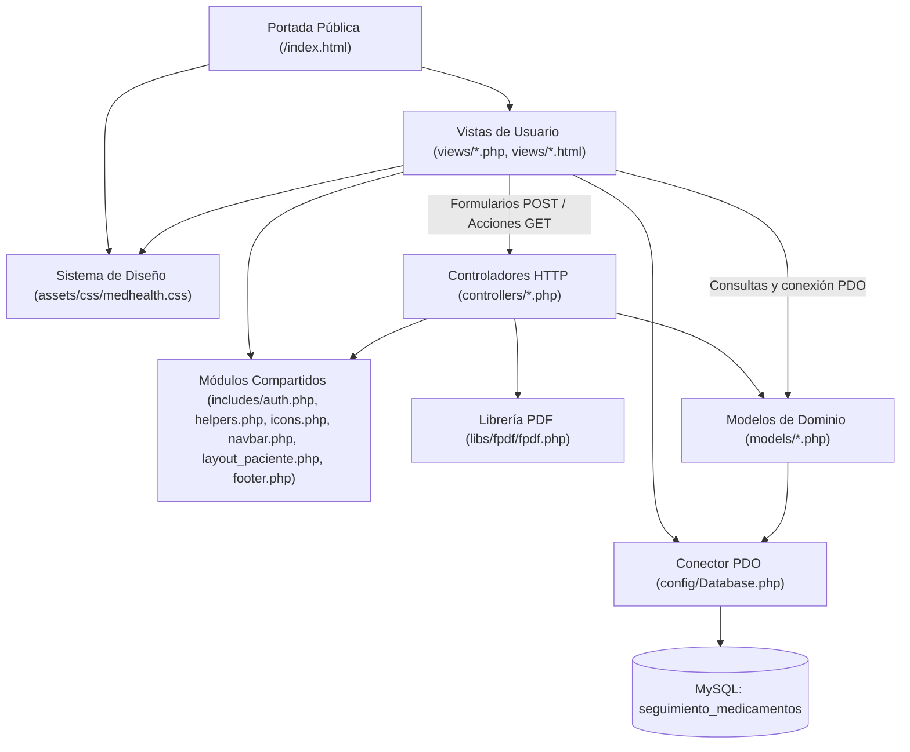

# Documentación de MedHealth (`care_sis`)

Este directorio (`docs/`) centraliza toda la documentación arquitectónica, el sistema de diseño, los contratos de interfaz de cada submódulo y el registro de auditoría de refactorización EGM.

## Índice de Documentos

- **[funcionalidades.md](file:///home/ruben/Documents/IPN/quinto_sem/Ing_Softw/proyecto/care_sis/docs/funcionalidades.md)**: Especificación detallada de todas las funcionalidades de la plataforma por módulo.
- **[medhealth-diseno.md](file:///home/ruben/Documents/IPN/quinto_sem/Ing_Softw/proyecto/care_sis/docs/medhealth-diseno.md)**: Guía de diseño MedHealth (tokens de color, tipografía `Atkinson Hyperlegible`, componentes y pantallas W1–W7 / P1–P15).
- **[config.md](file:///home/ruben/Documents/IPN/quinto_sem/Ing_Softw/proyecto/care_sis/docs/config.md)**: Configuración y conector PDO a la base de datos (`config/Database.php`).
- **[includes.md](file:///home/ruben/Documents/IPN/quinto_sem/Ing_Softw/proyecto/care_sis/docs/includes.md)**: Utilidades de sesión/autenticación, helpers de dominio, iconos SVG y parciales de layout (`includes/`).
- **[models.md](file:///home/ruben/Documents/IPN/quinto_sem/Ing_Softw/proyecto/care_sis/docs/models.md)**: Modelos de dominio y contratos de acceso a datos (`models/`).
- **[controllers.md](file:///home/ruben/Documents/IPN/quinto_sem/Ing_Softw/proyecto/care_sis/docs/controllers.md)**: Endpoints HTTP y controladores de negocio (`controllers/`).
- **[views.md](file:///home/ruben/Documents/IPN/quinto_sem/Ing_Softw/proyecto/care_sis/docs/views.md)**: Catálogo de vistas públicas (W1–W7) y protegidas (P1–P15) en `views/` e `index.html`.
- **[update_models.md](file:///home/ruben/Documents/IPN/quinto_sem/Ing_Softw/proyecto/care_sis/docs/update_models.md)**: Diccionario de datos y diagrama entidad-relación de la base de datos `seguimiento_medicamentos`.
- **[egm_lite_checklist.md](file:///home/ruben/Documents/IPN/quinto_sem/Ing_Softw/proyecto/care_sis/docs/egm_lite_checklist.md)**: Diagnóstico y checklist de refactorización bajo metodología EGM.

---

## Arquitectura General del Proyecto

El proyecto está organizado por responsabilidad funcional en las siguientes carpetas:

```text
care_sis/
├── index.html              # W1: Portada pública MedHealth
├── assets/
│   └── css/medhealth.css   # Sistema de diseño MedHealth (tokens, Atkinson Hyperlegible, layouts, componentes)
├── config/                 # Conexión PDO a la base de datos MySQL
├── includes/               # Autenticación, helpers, iconos SVG y barra lateral del paciente
├── models/                 # Capa de acceso a datos (9 modelos PDO para 10 tablas)
├── controllers/            # Procesamiento de formularios y acciones HTTP
├── views/                  # Vistas de aplicación (W2-W7 públicas y P1-P15 de paciente)
├── CSS/                    # style.css importa assets/css/medhealth.css (hojas heredadas)
├── Recursos/               # Logotipos e imágenes del sistema
├── libs/fpdf/              # Librería FPDF para generación de reportes PDF
└── docs/                   # Documentación técnica, diseño y contratos de arquitectura
```

### Flujo entre Submódulos


