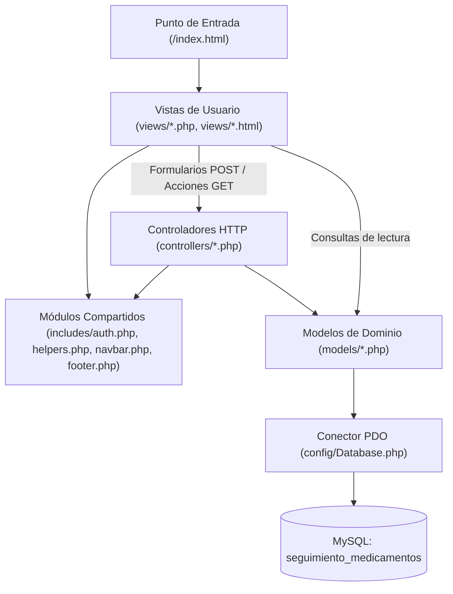

# Documentación de Cuidate+ (`care_sis`)

Este directorio (`docs/`) centraliza toda la documentación arquitectónica, los contratos de interfaz de cada submódulo y el registro de auditoría de refactorización EGM.

## Índice de Documentos

- **[config.md](file:///home/ruben/Documents/IPN/quinto_sem/Ing_Softw/proyecto/care_sis/docs/config.md)**: Configuración y conector PDO a la base de datos (`config/Database.php`).
- **[includes.md](file:///home/ruben/Documents/IPN/quinto_sem/Ing_Softw/proyecto/care_sis/docs/includes.md)**: Utilidades de sesión/autenticación, helpers de dominio y parciales de UI (`includes/`).
- **[models.md](file:///home/ruben/Documents/IPN/quinto_sem/Ing_Softw/proyecto/care_sis/docs/models.md)**: Modelos de dominio y contratos de acceso a datos (`models/`).
- **[controllers.md](file:///home/ruben/Documents/IPN/quinto_sem/Ing_Softw/proyecto/care_sis/docs/controllers.md)**: Endpoints HTTP y controladores de negocio (`controllers/`).
- **[views.md](file:///home/ruben/Documents/IPN/quinto_sem/Ing_Softw/proyecto/care_sis/docs/views.md)**: Catálogo de vistas públicas y protegidas (`views/` e `index.html`).
- **[update_models.md](file:///home/ruben/Documents/IPN/quinto_sem/Ing_Softw/proyecto/care_sis/docs/update_models.md)**: Diccionario de datos y diagrama entidad-relación de la base de datos `seguimiento_medicamentos`.
- **[egm_lite_checklist.md](file:///home/ruben/Documents/IPN/quinto_sem/Ing_Softw/proyecto/care_sis/docs/egm_lite_checklist.md)**: Diagnóstico y checklist de refactorización bajo metodología EGM.

---

## Arquitectura General del Proyecto

El proyecto está organizado por responsabilidad funcional en las siguientes carpetas:

```text
care_sis/
├── index.html              # Punto de entrada público de bienvenida
├── config/                 # Conexión PDO a la base de datos MySQL
├── includes/               # Autenticación, helpers y parciales UI (navbar, footer)
├── models/                 # Capa de acceso a datos (9 modelos PDO para 10 tablas)
├── controllers/            # Procesamiento de formularios y acciones HTTP
├── views/                  # Vistas de aplicación (.php protegidas y .html públicas)
├── CSS/                    # Hojas de estilo por vista y variables globales
├── Recursos/               # Logotipos e imágenes del sistema
├── libs/fpdf/              # Librería FPDF para generación de reportes PDF
└── docs/                   # Documentación técnica y contratos de arquitectura
```

### Flujo entre Submódulos


