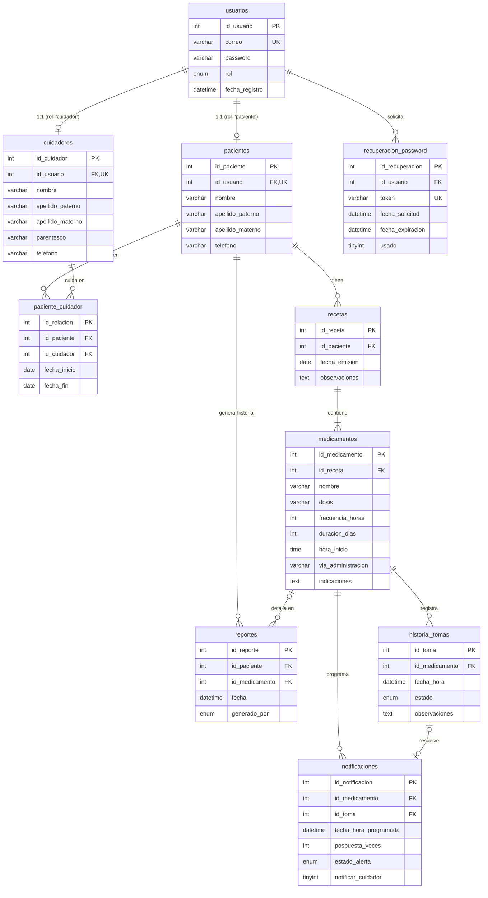

# Documentación de Base de Datos: Sistema Cuídate+ (`seguimiento_medicamentos`)

Este documento describe la arquitectura relacional del sistema **Cuídate+**, detallando las entidades, atributos, tipos de datos, restricciones de integridad y relaciones de cardinalidad extraídas del diagrama entidad-relación oficial.

---

## 1. Resumen de la Arquitectura

El esquema de base de datos está dividido en dos categorías según su estado de implementación en el código fuente:

* **Tablas Existentes (`models/`):** 8 tablas principales que soportan la gestión de usuarios, perfiles de pacientes y cuidadores, prescripciones médicas, registro de tomas y generación de reportes.
* **Tablas Propuestas / Faltantes:** 2 tablas adicionales (`recuperacion_password` y `notificaciones`) diseñadas para completar los flujos de seguridad (restablecimiento de credenciales) y el motor de alertas/recordatorios.

---

## 2. Diccionario de Datos

### Convenciones de Restricciones
* **PK:** *Primary Key* (Llave Primaria)
* **FK:** *Foreign Key* (Llave Foránea)
* **UQ:** *Unique* (Índice Único)
* **NN:** *Not Null* (No Nulo)
* **AI:** *Auto Increment* (Autoincremental)

---

### 2.1. Tablas Existentes

#### 1. `usuarios`
Almacena las credenciales de acceso y el rol base de cada actor dentro de la plataforma.

| Columna | Tipo de Dato | Restricciones | Descripción |
| :--- | :--- | :--- | :--- |
| `id_usuario` | `INT UNSIGNED` | `PK`, `AI` | Identificador único del usuario. |
| `correo` | `VARCHAR(100)` | `UQ`, `NN` | Correo electrónico utilizado para el inicio de sesión. |
| `password` | `VARCHAR(255)` | `NN` | Hash de la contraseña del usuario. |
| `rol` | `ENUM('paciente','cuidador')` | `NN` | Define el perfil funcional del usuario en el sistema. |
| `fecha_registro` | `DATETIME` | `DEFAULT NOW` | Fecha y hora en que se creó la cuenta. |

---

#### 2. `pacientes`
Contiene la información demográfica y de contacto de los usuarios con rol de paciente.

| Columna | Tipo de Dato | Restricciones | Descripción |
| :--- | :--- | :--- | :--- |
| `id_paciente` | `INT UNSIGNED` | `PK`, `AI` | Identificador único del paciente. |
| `id_usuario` | `INT UNSIGNED` | `FK`, `UQ`, `NN` | Referencia a `usuarios(id_usuario)`. Relación 1:1. |
| `nombre` | `VARCHAR(100)` | `NN` | Nombre(s) del paciente. |
| `apellido_paterno` | `VARCHAR(100)` | `NN` | Primer apellido del paciente. |
| `apellido_materno` | `VARCHAR(100)` | `NULL` | Segundo apellido del paciente (opcional). |
| `telefono` | `VARCHAR(20)` | `NULL` | Número telefónico de contacto. |

---

#### 3. `cuidadores`
Almacena los datos personales de los responsables o familiares encargados de supervisar a uno o más pacientes.

| Columna | Tipo de Dato | Restricciones | Descripción |
| :--- | :--- | :--- | :--- |
| `id_cuidador` | `INT UNSIGNED` | `PK`, `AI` | Identificador único del cuidador. |
| `id_usuario` | `INT UNSIGNED` | `FK`, `UQ`, `NN` | Referencia a `usuarios(id_usuario)`. Relación 1:1. |
| `nombre` | `VARCHAR(100)` | `NN` | Nombre(s) del cuidador. |
| `apellido_paterno` | `VARCHAR(100)` | `NN` | Primer apellido del cuidador. |
| `apellido_materno` | `VARCHAR(100)` | `NULL` | Segundo apellido del cuidador (opcional). |
| `parentesco` | `VARCHAR(50)` | `NN` | Relación familiar o profesional con el paciente. |
| `telefono` | `VARCHAR(20)` | `NN` | Número telefónico obligatorio para alertas y contacto. |

---

#### 4. `paciente_cuidador`
Tabla pivote que resuelve la relación muchos a muchos ($N:M$) entre pacientes y cuidadores, manteniendo un historial de vigencia.

| Columna | Tipo de Dato | Restricciones | Descripción |
| :--- | :--- | :--- | :--- |
| `id_relacion` | `INT UNSIGNED` | `PK`, `AI` | Identificador único del vínculo. |
| `id_paciente` | `INT UNSIGNED` | `FK`, `NN` | Referencia a `pacientes(id_paciente)`. |
| `id_cuidador` | `INT UNSIGNED` | `FK`, `NN` | Referencia a `cuidadores(id_cuidador)`. |
| `fecha_inicio` | `DATE` | `NN` | Fecha en que inicia la asignación del cuidado. |
| `fecha_fin` | `DATE` | `NULL` | Fecha de término de la relación (`NULL` si sigue activa). |

---

#### 5. `recetas`
Agrupa las prescripciones médicas emitidas para un paciente específico.

| Columna | Tipo de Dato | Restricciones | Descripción |
| :--- | :--- | :--- | :--- |
| `id_receta` | `INT UNSIGNED` | `PK`, `AI` | Identificador único de la receta médica. |
| `id_paciente` | `INT UNSIGNED` | `FK`, `NN` | Referencia a `pacientes(id_paciente)`. |
| `fecha_emision` | `DATE` | `NN` | Fecha en la que se expidió la receta. |
| `observaciones` | `TEXT` | `NULL` | Notas generales o diagnóstico asociado a la receta. |

---

#### 6. `medicamentos`
Detalla cada fármaco prescrito dentro de una receta, incluyendo su pauta posológica y horarios.

| Columna | Tipo de Dato | Restricciones | Descripción |
| :--- | :--- | :--- | :--- |
| `id_medicamento` | `INT UNSIGNED` | `PK`, `AI` | Identificador único del medicamento prescrito. |
| `id_receta` | `INT UNSIGNED` | `FK`, `NN` | Referencia a `recetas(id_receta)`. |
| `nombre` | `VARCHAR(150)` | `NN` | Nombre comercial o genérico del fármaco. |
| `dosis` | `VARCHAR(100)` | `NN` | Cantidad o concentración por toma (ej. `500 mg`, `1 tableta`). |
| `frecuencia_horas` | `INT` | `NN` | Intervalo en horas entre cada dosis (ej. `8`, `12`, `24`). |
| `duracion_dias` | `INT` | `NN` | Total de días que debe durar el tratamiento. |
| `hora_inicio` | `TIME` | `NN` | Hora programada para la primera toma del tratamiento. |
| `via_administracion` | `VARCHAR(50)` | `NN` | Vía de ingesta o aplicación (ej. `Oral`, `Intravenosa`, `Tópica`). |
| `indicaciones` | `TEXT` | `NULL` | Instrucciones específicas (ej. *"Tomar después de los alimentos"*). |

---

#### 7. `historial_tomas`
Registra el cumplimiento efectivo u omisión de cada dosis programada de un medicamento.

| Columna | Tipo de Dato | Restricciones | Descripción |
| :--- | :--- | :--- | :--- |
| `id_toma` | `INT UNSIGNED` | `PK`, `AI` | Identificador único del registro de toma. |
| `id_medicamento` | `INT UNSIGNED` | `FK`, `NN` | Referencia a `medicamentos(id_medicamento)`. |
| `fecha_hora` | `DATETIME` | `NN` | Marca de tiempo exacta en la que se registró el evento. |
| `estado` | `ENUM('tomado','no_tomado')` | `NN` | Indica si el paciente consumió o no la dosis. |
| `observaciones` | `TEXT` | `NULL` | Comentarios adicionales (ej. motivo de omisión o efectos secundarios). |

---

#### 8. `reportes`
Almacena la bitácora de reportes de adherencia generados por los distintos actores o procesos automáticos.

| Columna | Tipo de Dato | Restricciones | Descripción |
| :--- | :--- | :--- | :--- |
| `id_reporte` | `INT UNSIGNED` | `PK`, `AI` | Identificador único del reporte. |
| `id_paciente` | `INT UNSIGNED` | `FK`, `NN` | Referencia a `pacientes(id_paciente)` evaluado. |
| `id_medicamento` | `INT UNSIGNED` | `FK`, `NULL` | Referencia opcional a `medicamentos(id_medicamento)` (si es específico). |
| `fecha` | `DATETIME` | `NN` | Fecha y hora de generación del reporte. |
| `generado_por` | `ENUM('sistema','cuidador','paciente')` | `NN` | Origen que disparó la creación del reporte. |

---

### 2.2. Tablas Propuestas (Nuevas / Faltantes)

#### 9. `recuperacion_password`
Gestiona los tokens temporales de un solo uso para el restablecimiento seguro de contraseñas.

| Columna | Tipo de Dato | Restricciones | Descripción |
| :--- | :--- | :--- | :--- |
| `id_recuperacion` | `INT UNSIGNED` | `PK`, `AI` | Identificador único de la solicitud. |
| `id_usuario` | `INT UNSIGNED` | `FK`, `NN` | Referencia a `usuarios(id_usuario)` que solicita el cambio. |
| `token` | `VARCHAR(255)` | `UQ`, `NN` | Código único de verificación enviado al correo del usuario. |
| `fecha_solicitud` | `DATETIME` | `NN` | Marca de tiempo de creación del token. |
| `fecha_expiracion` | `DATETIME` | `NN` | Límite de validez del token. |
| `usado` | `TINYINT(1)` | `DEFAULT 0` | Bandera booleana (`0`: disponible, `1`: ya utilizado). |

---

#### 10. `notificaciones`
Controla la cola de alarmas programadas, posposiciones (*snooze*) y escalamiento de alertas hacia el cuidador.

| Columna | Tipo de Dato | Restricciones | Descripción |
| :--- | :--- | :--- | :--- |
| `id_notificacion` | `INT UNSIGNED` | `PK`, `AI` | Identificador único de la alerta. |
| `id_medicamento` | `INT UNSIGNED` | `FK`, `NN` | Referencia a `medicamentos(id_medicamento)` asociado. |
| `id_toma` | `INT UNSIGNED` | `FK`, `NULL` | Referencia a `historial_tomas(id_toma)` una vez que la alerta es atendida. |
| `fecha_hora_programada` | `DATETIME` | `NN` | Momento exacto en que debe dispararse el recordatorio. |
| `pospuesta_veces` | `INT` | `DEFAULT 0` | Contador de veces que el usuario ha pospuesto la alarma. |
| `estado_alerta` | `ENUM('pendiente','pospuesta','atendida','vencida')` | `NN` | Estado actual dentro del ciclo de vida de la notificación. |
| `notificar_cuidador` | `TINYINT(1)` | `DEFAULT 0` | Indica si se debe alertar al cuidador (`1`: sí, `0`: no, ej. tras vencer). |

---

## 3. Matriz de Relaciones y Cardinalidad

A continuación se detallan las 12 relaciones que estructuran la integridad referencial del modelo:

| Entidad Origen | Cardinalidad | Entidad Destino | Llave Foránea | Regla de Negocio |
| :--- | :---: | :--- | :--- | :--- |
| `usuarios` | `1 : 0..1` | `pacientes` | `pacientes.id_usuario` | Un usuario con `rol = 'paciente'` tiene exactamente un perfil de paciente. |
| `usuarios` | `1 : 0..1` | `cuidadores` | `cuidadores.id_usuario` | Un usuario con `rol = 'cuidador'` tiene exactamente un perfil de cuidador. |
| `usuarios` | `1 : 0..N` | `recuperacion_password` | `recuperacion_password.id_usuario` | Un usuario puede generar múltiples solicitudes de recuperación a lo largo del tiempo. |
| `pacientes` | `1 : 0..N` | `paciente_cuidador` | `paciente_cuidador.id_paciente` | Un paciente puede tener asignados uno o varios cuidadores (activos o históricos). |
| `cuidadores` | `1 : 0..N` | `paciente_cuidador` | `paciente_cuidador.id_cuidador` | Un cuidador puede supervisar a múltiples pacientes simultáneamente. |
| `pacientes` | `1 : 0..N` | `recetas` | `recetas.id_paciente` | Un paciente puede contar con múltiples recetas médicas registradas. |
| `recetas` | `1 : 1..N` | `medicamentos` | `medicamentos.id_receta` | Toda receta debe contener al menos un medicamento prescrito. |
| `pacientes` | `1 : 0..N` | `reportes` | `reportes.id_paciente` | Un paciente puede tener múltiples reportes históricos de seguimiento. |
| `medicamentos` | `0..1 : 0..N` | `reportes` | `reportes.id_medicamento` | Un reporte puede filtrar un medicamento específico o abarcar todo el tratamiento (`NULL`). |
| `medicamentos` | `1 : 0..N` | `historial_tomas` | `historial_tomas.id_medicamento` | Cada medicamento genera múltiples registros de toma durante su duración. |
| `medicamentos` | `1 : 0..N` | `notificaciones` | `notificaciones.id_medicamento` | Cada medicamento programa múltiples notificaciones según su frecuencia y duración. |
| `historial_tomas` | `0..1 : 0..1` | `notificaciones` | `notificaciones.id_toma` | Cuando una notificación es atendida, se vincula directamente con el registro en el historial de tomas. |

---

## 4. Diagrama Entidad-Relación (Mermaid)

Para facilitar su visualización directa en repositorios (GitHub/GitLab) o gestores de documentación (Notion, Obsidian), se incluye la representación equivalente en sintaxis Mermaid:

